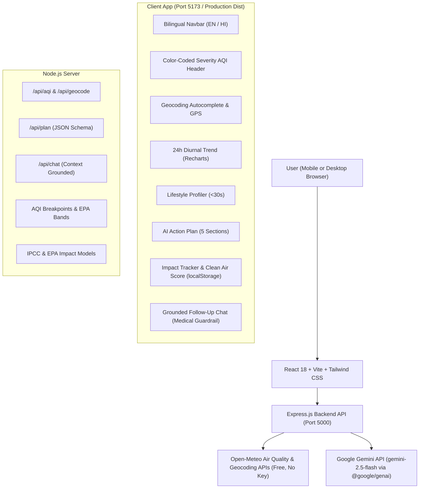

# CleanBreath 🌿 | AI Urban Air Quality Assistant
> **Google PromptWars Virtual — Challenge 6: "Urban Air Quality Assistant"**  
> A mobile-first, GenAI-powered web app helping families and communities navigate severe winter smog with personalized low-emission routines, indoor air quality hacks, and transparent impact tracking.

[](#tech-stack)
[](#how-gemini-is-used)
[-F59E0B.svg)](#live-aqi-integration)
[](#features)

---

## Architecture Overview



---

## Core Features

1. **Location & Live AQI**:
   - Geocoding autocomplete and HTML5 "Use My Location" GPS button.
   - Live metrics: US AQI, PM2.5, PM10, NO2, O3, and dominant pollutant.
   - High-contrast, color-coded severity banner (Good, Moderate, Sensitive, Unhealthy, Very Unhealthy, Hazardous).
   - 24-hour diurnal trend chart powered by Recharts (visualizing morning/night inversion peaks).
   - **Graceful manual AQI fallback**: accessible modal to simulate any smog scenario or work offline.

2. **30-Second Lifestyle Profile**:
   - Household sensitivity: Children, elderly, asthma/respiratory vulnerability, pets.
   - Commute: Car, two-wheeler, public transit, walk/cycle, work from home.
   - Home living: Apartment/house, air purifier, window sealing, cooking fuel (gas/induction/biomass).
   - Budget tier: Low (DIY focus), Medium (balanced), High (smart appliances).

3. **Gemini 2.5 Flash Action Plan (Structured JSON)**:
   - **Today's Risk Summary**: Empathetic, plain-language risk breakdown for this specific household.
   - **Low-Emission Daily Routine**: Time-blocked schedule tailored around atmospheric inversion layer shifts.
   - **Indoor Air Quality Hacks**: Ranked by cost and effectiveness. Includes $30 DIY box fan + MERV 13 filter guidance, ventilation windows, and scientific mythbusting on houseplants.
   - **Sustainable Alternatives**: Practical swaps for travel, cooking, heating, and waste burning matching user budget.
   - **Impact Explainer**: Transparently quantifies avoided emissions (grams CO2) and personal PM2.5 exposure reductions with disclosed engineering assumptions.

4. **Impact Tracker & Clean Air Score**:
   - Interactive daily checklist.
   - Running Clean Air Score (0-100 scale).
   - Avoided CO2 counter and exposure reduction percentage.
   - Automatically persisted in browser `localStorage`.

5. **Context-Grounded Follow-Up Chat**:
   - Conversational assistant grounded in exact live AQI numbers and household profile.
   - **Strict Medical Safety Guardrail**: Never diagnoses; detects symptoms like wheezing, chest pain, or coughing and immediately directs users to medical professionals.

6. **Bilingual Accessibility**:
   - Seamless one-click English ⇄ Hindi (हिंदी) localization for Indian urban centers facing severe winter smog (e.g. Delhi NCR, Mumbai, Patna).

---

## How Gemini is Used & Prompt Engineering

- **Model**: `gemini-2.5-flash` via the official Google Gen AI SDK (`@google/genai`).
- **Structured JSON Schema**: Enforced through `responseMimeType: "application/json"` and strict JSON schema definitions for reliable UI rendering.
- **Strict Grounding**: System instructions explicitly prohibit inventing or hallucinating AQI numbers. All guidance is calibrated directly against the exact live PM2.5, PM10, NO2, and US AQI readings passed in the prompt.
- **EPA Calibration**: Action advice strictly mirrors standard EPA health categories (0-50 Good through 301+ Hazardous).
- **Graceful Fallback**: If an API key is not yet set or rate limits occur, CleanBreath seamlessly activates a calibrated deterministic engine that outputs the exact same JSON schema and grounded numbers.

---

## Scientific Assumptions Behind Impact Estimates

CleanBreath discloses all underlying environmental engineering assumptions directly in the UI and codebase (`server/src/utils/impactCalc.js`):

| Action | Metric | Estimated Impact | Baseline Engineering Assumptions |
|---|---|---|---|
| **Car to Metro Swap** | CO2 Avoided | ~1,400 g CO2 / 10 km trip | Average ICE car: ~170 g CO2/km (IPCC/EPA avg); Electric Metro: ~30 g CO2/pkm. |
| **Two-Wheeler to Walk/Cycle** | CO2 Avoided | ~275 g CO2 / 5 km trip | 100-150cc petrol scooter: ~55 g CO2/km; Active transit: 0 g CO2. |
| **N95 / FFP2 Mask Outdoors** | Inhaled PM2.5 Reduction | ~90% reduction | Genuine NIOSH N95 / EN149 FFP2 mask with good perimeter seal vs ambient air. |
| **HEPA Purifier in Sealed Room** | Indoor PM2.5 Reduction | ~75% - 85% reduction | Standard CADR rating in a closed 12x12 bedroom within 45-60 minutes. |
| **DIY Box Fan + MERV-13 Filter** | Inhaled Particulate Cut | ~70% reduction | 20x20 box fan taped to MERV-13 filter (UC Davis / Corsi-Rosenthal studies). |
| **Midday Ventilation (12-3 PM)** | Smog Infiltration Avoided | ~35% reduction | Solar heating lifts ground-level thermal inversion layer, dispersing peak ground smog. |
| **Induction vs Gas Cooking** | Kitchen PM2.5 & NO2 Cut | ~85% reduction | Eliminates open flame combustion byproducts (NO2, CO, soot) in indoor kitchens. |
| **Wet Mopping vs Dry Sweeping** | Dust Resuspension Cut | ~55% reduction | Dry brooms resuspend up to 60% of settled fine particles into breathing level. |

---

## Quickstart & Local Setup

### Prerequisites
- Node.js 18+ (tested on Node 20 / 24)
- npm 9+
- *(Optional)* Gemini API Key from [Google AI Studio](https://aistudio.google.com/)

### 1. Clone & Install
```bash
git clone <repo-url>
cd "challange 6"

# Install root, server, and client dependencies
npm run install:all
```

### 2. Configure Environment (Optional)
```bash
# Copy example .env
cp .env.example .env

# Edit .env and paste your Gemini API Key
GEMINI_API_KEY=your_gemini_api_key_here
```
*(Note: If `GEMINI_API_KEY` is omitted, CleanBreath automatically runs in offline calibrated mode with 100% full functionality!)*

### 3. Run Development Server
```bash
npm run dev
```
- Frontend opens at: `http://localhost:5173`
- Backend API runs at: `http://localhost:5000`

### 4. Run Unit Tests
```bash
npm test
```
Runs 8 automated unit tests verifying AQI-band breakpoint math, color tokens, and impact calculation formulas.

---

## Deployment Guides

### Option A: Google Cloud Run (Recommended)

1. Create a `Dockerfile` in the root:
```dockerfile
FROM node:20-alpine AS build
WORKDIR /app
COPY . .
RUN npm install
RUN npm install --prefix server
RUN npm install --prefix client
RUN npm run build --prefix client

FROM node:20-alpine
WORKDIR /app
COPY --from=build /app/server /app/server
COPY --from=build /app/client/dist /app/client/dist
COPY --from=build /app/package.json /app/package.json
ENV NODE_ENV=production
ENV PORT=8080
EXPOSE 8080
CMD ["node", "server/src/server.js"]
```

2. Build and deploy with Google Cloud CLI:
```bash
gcloud run deploy cleanbreath \
  --source . \
  --platform managed \
  --region us-central1 \
  --allow-unauthenticated \
  --set-env-vars GEMINI_API_KEY=your_key_here
```

### Option B: Vercel

1. Create a `vercel.json` in the root:
```json
{
  \"version\": 2,
  \"builds\": [
    { \"src\": \"client/package.json\", \"use\": \"@vercel/static-build\", \"config\": { \"distDir\": \"dist\" } },
    { \"src\": \"server/src/server.js\", \"use\": \"@vercel/node\" }
  ],
  \"routes\": [
    { \"src\": \"/api/(.*)\", \"dest\": \"/server/src/server.js\" },
    { \"src\": \"/(.*)\", \"dest\": \"/client/$1\" }
  ]
}
```
2. Run `vercel deploy` and configure `GEMINI_API_KEY` in Project Settings > Environment Variables.

---

## Hackathon Demo Script
A complete 60-90 second presentation script is available in [docs/demo.md](file:///c:/Users/Lokesh/OneDrive/Desktop/challange%206/docs/demo.md).

---

## License
MIT © 2026 CleanBreath Team — Google PromptWars Challenge 6.
